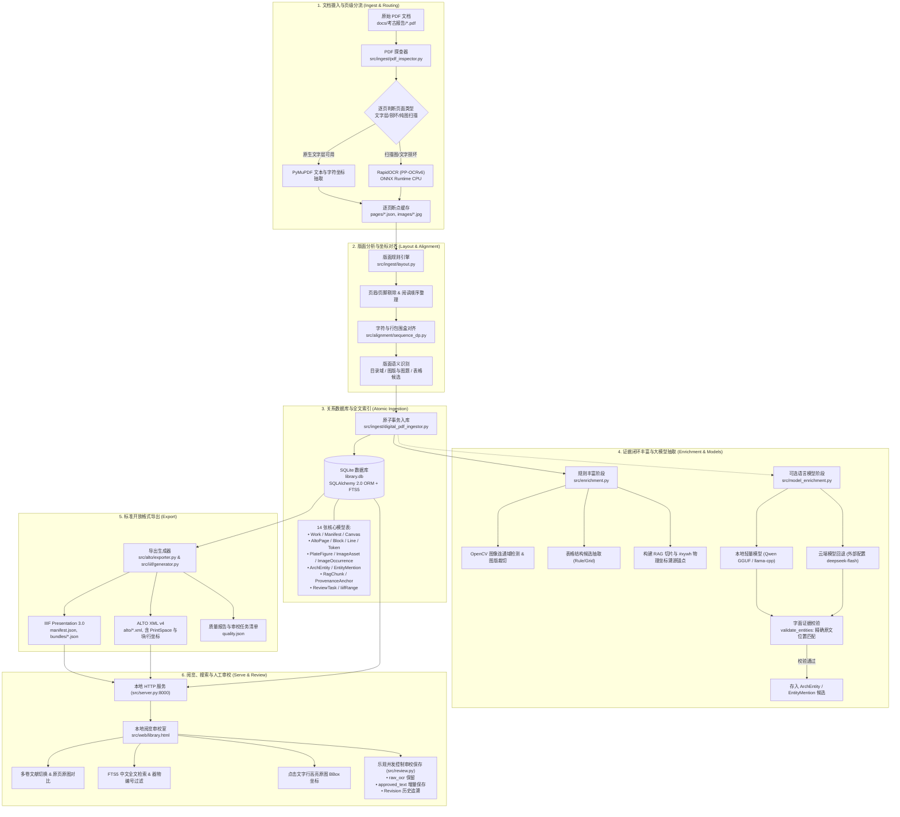

# 大模型与人文数据处理

北京大学课程“大模型与人文数据处理”的考古方向小组仓库。

本仓库用于保存课程作业、文本数据处理实验、可复用的 Python 工具、Jupyter Notebook、报告与课程笔记。探索性分析放在 Notebook 中；可复用的数据处理逻辑应整理到 `src/`，并尽量通过 `scripts/` 中的脚本重复执行。

## 环境要求

- Python 3.11 或更高版本
- Git

## 安装

```bash
python3 -m venv .venv
source .venv/bin/activate
pip install -r requirements.txt
```

目前已实现考古 PDF 的本地数字化流程，包含嵌字提取、逐页扫描 OCR、断点缓存、结构化入库、ALTO/IIIF 导出及本地阅览审校。部署、模型和外部 API 配置见 [操作说明](docs/digitization_runbook.md)。

## 工作流架构

本项目针对考古报告与人文历史文献的高保真数字化、版面还原、知识抽取与交互审校，设计了全流程、可追溯、原子化保障的流水线：



## 目录结构

```text
.
├── notebooks/        # Jupyter Notebook：探索与演示
├── src/              # 可复用的 Python 源码
├── data/
│   ├── raw/          # 原始数据（默认不提交）
│   └── processed/    # 处理后数据
├── assignments/      # 课程作业
├── experiments/      # 实验代码
├── reports/          # 报告、图表和结果
├── scripts/          # 可重复执行的脚本
└── docs/             # 课程笔记与技术文档
```

## 运行方法

激活虚拟环境后，从项目根目录运行脚本，例如：

```bash
python scripts/example.py
```

后续新增的脚本与实验应在对应文档或作业说明中记录使用方法。

## 数据说明

原始数据存放在 `data/raw/`，默认不纳入 Git；处理后的数据存放在 `data/processed/`。请勿提交 API 密钥、访问令牌、个人信息或大型数据文件。数据来源、获取方式和处理流程请记录在 [data/README.md](data/README.md)。
