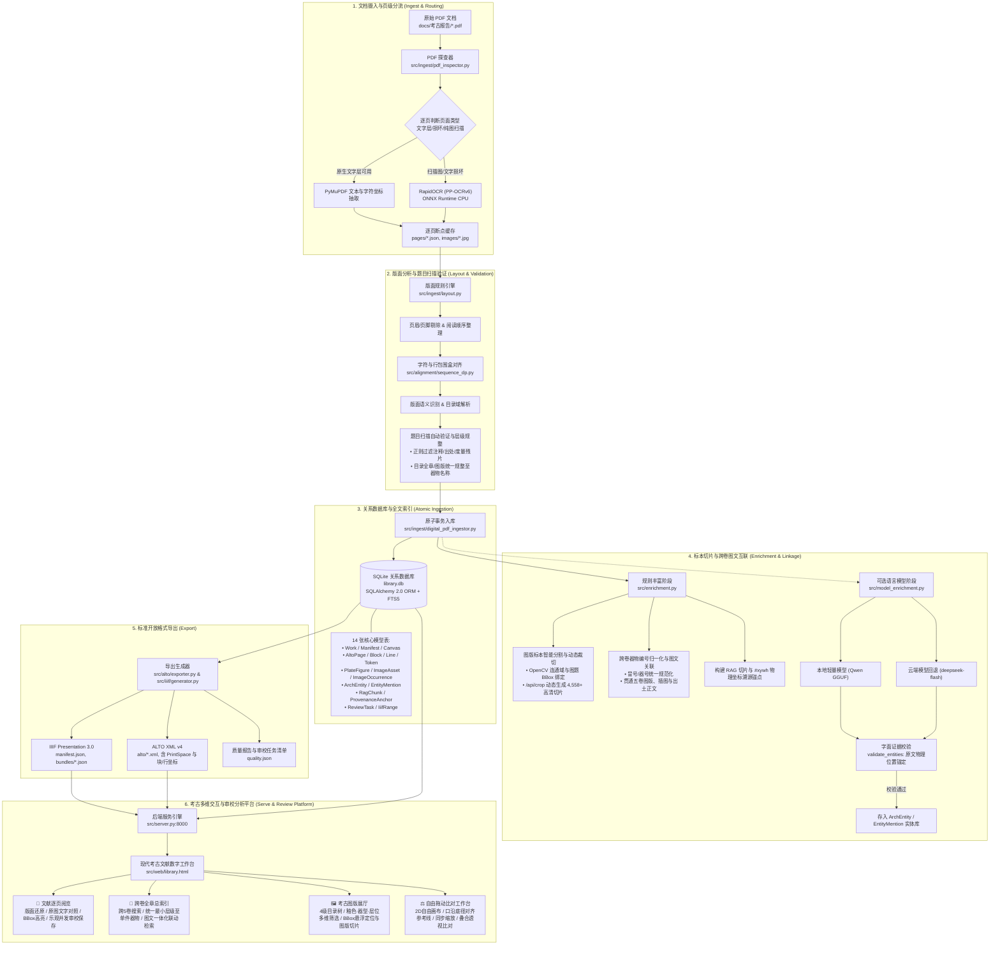

# 大模型与人文数据处理

北京大学课程“大模型与人文数据处理”的考古方向小组仓库。

本仓库用于保存课程作业、文本数据处理实验、可复用的 Python 工具、Jupyter Notebook、报告与课程笔记。探索性分析放在 Notebook 中；可复用的数据处理逻辑应整理到 `src/`，并尽量通过 `scripts/` 中的脚本重复执行。

## 环境要求

- Python 3.11 或更高版本
- Git

## 安装

```bash
python3 -m venv .venv
source .venv/bin/activate
pip install -r requirements.txt
```

目前已实现考古 PDF 的本地数字化流程，包含嵌字提取、逐页扫描 OCR、断点缓存、结构化入库、ALTO/IIIF 导出及本地阅览审校。部署、模型和外部 API 配置见 [操作说明](docs/digitization_runbook.md)。

## 工作流架构

本项目针对考古报告与人文历史文献的高保真数字化、版面还原、知识抽取、图文互联与交互审校比对，设计了全流程、可追溯、原子化保障的流水线：



### 核心功能与平台特性

1. **题目扫描自动验证与层级规整（统一至器物粒度）**
   - 自动过滤 OCR 扫描中误识别为标题的页下注、古籍文献引注、标本测量尺寸及非标题残片。
   - 统一“目录全章”（TOC）与“仅图片”（图版展厅）两套导航树的最小层级，均下钻规整至**单件器物名称**（如“青釉盏”、“素面执壶”等），支持按卷册、章节或器物快速定位与检索。

2. **图版标本智能分割与动态切片 (`/api/crop`)**
   - 结合版面规则与 OpenCV 连通域轮廓检测，自动识别整页大图版中的独立器物 BBox。
   - 后端动态提取并裁剪生成超过 4,558+ 处高清独立标本图版切片，彻底突破整页大图版中多器物难以单独观摩分析的痛点。

3. **跨卷图文一体化联动检索 (Cross-Volume Index Hub)**
   - 针对多卷本考古报告（正文卷、图录卷、报告补编等）建立冒号/标点规范化的器物编号索引体系。
   - 支持跨卷快速反查：正文出土记录一键直达对应图版大图与切片，图版切片一键直通各卷上下文考证。

4. **多模式自由比对工作台 (2D Lighttable Canvas)**
   - **自由拖拽摆放**：支持将展厅或目录中任意器物标本卡片拖拽至 2D 自由排版画布中任意排列布局。
   - **器物对齐基准线**：内置可上下移动的标尺参考线，便于研究者直观对齐不同标本的口沿高度、器腹弧度与圈足底径。
   - **分屏同步与叠合透视**：支持多件器物联动等比缩放、同层位/同类型器物正背底叠合对比，深度赋能考古类型学演变研究。

5. **IIIF / ALTO 开放标准与原子审校**
   - 完整支持 IIIF Presentation 3.0 与 ALTO XML v4 开放数字人文标准。
   - 前端集成双向锚定高亮与乐观并发控制版本追溯，保障人工修正不破坏原始扫描与模型抽取证据链。

## 目录结构

```text
.
├── notebooks/        # Jupyter Notebook：探索与演示
├── src/              # 可复用的 Python 源码
├── data/
│   ├── raw/          # 原始数据（默认不提交）
│   └── processed/    # 处理后数据
├── assignments/      # 课程作业
├── experiments/      # 实验代码
├── reports/          # 报告、图表和结果
├── scripts/          # 可重复执行的脚本
└── docs/             # 课程笔记与技术文档
```

## 运行方法

图表检测、结构化识别、暂存审校与发布命令见 [图表工作流](docs/graphics-workflow.md)。

激活虚拟环境后，从项目根目录运行脚本，例如：

```bash
python scripts/example.py
```

后续新增的脚本与实验应在对应文档或作业说明中记录使用方法。

## 数据说明

原始数据存放在 `data/raw/`，默认不纳入 Git；处理后的数据存放在 `data/processed/`。请勿提交 API 密钥、访问令牌、个人信息或大型数据文件。数据来源、获取方式和处理流程请记录在 [data/README.md](data/README.md)。
