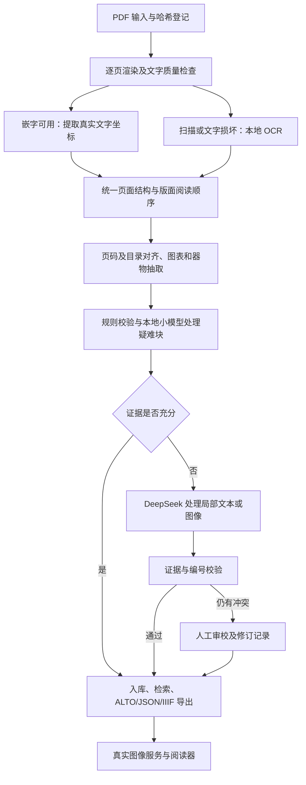

# 考古文献数字化部署检查与自动处理工作流补齐方案

检查日期：2026-10-30（北京时间）。范围：本地仓库、现有 SQLite 数据库、Python 环境、硬件、少量真实 PDF 页面及官方模型文档。本报告中的“已完成”表示有代码或数据证据，不表示已经上线。

## 1. 当前结论

项目处于**嵌字 PDF 入库原型已经跑通、通用自动处理与服务部署尚未完成**的阶段。

- 本地数据库已有《景德镇落马桥遗址》第一卷全部 412 页，不只是演示数据。
- 已有 PDF 探查、文字提取、页码序列对齐、规则目录/器物编号抽取、ALTO 入库与 IIIF JSON 生成组件。
- 尚未发现扫描 PDF OCR 执行器、模型路由、任务编排、HTTP 服务、阅读器或部署配置。本机常用模型/服务端口未发现监听；这不能排除其他端口或其他机器上的服务。
- 代码中的 `https://lab.pku.edu.cn/iiif` 是硬编码地址，不能作为已经部署的证据。没有独立验证外部主机状态。
- 第一卷的数据质量仍需修复，尤其是坐标、目录范围和页码误判。接入更多模型之前应先解决这些基础问题。

完整机器可读记录见 `reports/deployment_audit_2026-10-30.json`。原数据库仅做只读查询；冒烟运行使用自动清理的独立临时数据库。

## 2. 有证据的进度

| 环节 | 当前证据 | 判断 |
| --- | --- | --- |
| 环境 | `.venv/Scripts/python.exe` 可导入 pypdf 6.21.2 / SQLAlchemy 2.1.6 | 本地可运行；系统默认 Python 缺少这两项依赖 |
| 文献探查 | 已保存 7 份 PDF、共 2,765 页的探查报告 | 有抽样探查，尚非逐页质量路由 |
| 正式入库 | 1 部作品、1 卷、412 个 Canvas / ALTO Page | 仅第一卷有实际入库证据 |
| 文字 | 3,072 块、11,251 行、11,251 条 IIIF 标注 | 有行级文字；ALTO token 为 0 |
| 目录与器物 | 36 个目录节点、1,995 个器物编号、3,077 次出现、1,995 个索引词条 | 规则抽取已经产出数据，尚无人工准确率评测 |
| 图版 | 189 条图版记录 | 图题/启发式裁切记录，未证明图像边界正确 |
| 审校 | 67 项 pending，页面状态为 345 项 auto_accepted / 67 项 needs_review | 有任务表，未发现闭环审校界面 |
| 通用实体/图像管理 | image_assets、image_occurrences、arch_entities、entity_mentions 均为 0 | 有模型定义，真实文献生成链路缺失 |
| 图文互链 | figure_mentions 为 0 | ALTO 路径有链接函数，嵌字 PDF 主流程尚未接通 |
| RAG | rag_chunks、provenance_anchors 均为 0 | 有表结构和演示写入，真实卷未生成 |
| IIIF | 独立 12 页冒烟运行成功生成 Manifest 和 Page Bundle | JSON 构造可用；缺真实图像服务与 HTTP 路由 |

此次 12 页冒烟运行：222 块、279 行，入库函数耗时约 0.54 秒，产生 11 项异常。样本主要是卷首，**不能据此推算全书 OCR 速度或质量**。数据库外键检查无异常，行框未发现越出 Canvas，但这不代表框选准确。

## 3. 应先修复的已有问题

### P0：数据安全与可重复执行

`scripts/ingest_luomaqiao_vol1.py:47-51` 会删除目标 SQLite 文件；它是清库基准脚本，不能直接承担正式批量导入。`DigitalPdfIngestor.ingest_pdf()` 每次新建 Work，未实现以文件哈希和配置版本为依据的去重、续跑和多卷复用。

正式入口需做到：不默认清库；同一本重跑不重复；逐页事务/检查点；失败可重试；重跑受影响的阶段而非全书重做。已有整卷事务能回滚失败，但不能恢复中断进度。

### P0：嵌字 PDF 坐标不准确

`src/ingest/digital_pdf_ingestor.py:504` 后的提取逻辑忽略 `_cm` 变换矩阵，用文字长度和 font_size 估算宽度。当前样本中的字体缩放使该估计明显偏小。

物理第 137 页的“标本1，F12∶109……”一行：

- 当前提取器：x≈98.93，y≈126.62，w≈39.95，h=10 pt。
- PyMuPDF 独立提取：x≈98.93，y≈116.03，w≈431.00，h≈14.82 pt。
- 渲染页面核对后，文字确实横跨正文大部分行宽，当前框无法正确高亮原文。

建议优先改用 PyMuPDF 的 span/字符实际 bbox，统一处理 CropBox、旋转和坐标变换；保留原文与提取来源。若分发包含 PyMuPDF 的软件，应在依赖选择时确认其许可要求。

### P0：目录与页码存在误判

数据库将物理第 5—69 页共 65 页标为 toc；抽样第 69 页已有正文和印刷页码 11，说明目录域发生延续误判。大量前部页面还被统一分配为目录页码 1。

67 项待审校中包含 54 项 duplicate_scan、12 项 low_mapping_confidence、1 项 missing_page_gap。**这些是算法判断，不是已经确认的重复扫描或缺页。** 目前不能按该标签自动删页。真实嵌字入口没有提供页面视觉相似度，重复页须追加图像相似度及文字证据。

应使用印刷页码、目录条目版式、正文起点和章节锚点联合分域；不要仅将首尾“目录提示”之间全部页强制标为目录。当前置信度常量 1.0 / 0.98 也不应被解释为校准后的正确率。

### P0：整本分类不适合混合考古报告

`PdfInspector` 以“有文字且较多采样页有图片”判断 hybrid_ocr，会把嵌字图版卷与带 OCR 的扫描卷混在一起。实际抽样：

- 第三至六卷的图版页通常含多个图片对象与可直接提取的文字，不能整本强制 OCR。
- 《观台磁州窑址》物理第 1、5、397 页无可提取文字，最后一页只有少量文字，必须有逐页 OCR 分流。

分类应改为页级质量判断：文本可用、需 OCR、图像为主且已有图题、待审校。低文字量可能是封面、空白或图版，不能单独作为 OCR 判据；结合页面渲染与文字区域检测。

### P1：图版、检索与配置尚未闭环

- 图版裁切当前采用“图题上方固定 400 像素”，不是图像检测。需要识别真实图版及子图边界，关联图号、图题、标本号，并在全卷入库后统一解析跨页引用。
- `configs/heading_rules.yaml` 未发现加载入口；它与代码硬编码标题层级还不完全一致。应建立一个实际生效的配置来源。
- FTS5 使用 unicode61。实测“青花”：正文子串检索命中 1,019 行，FTS MATCH 命中 13 行。这是分词/检索语义差异，显示现配置不能满足中文子串检索需求；不能把两者直接当作统一准确率比较。现有 `search_text_coordinates()` 使用 contains，并非 FTS 接口。
- 图版 FTS 缺更新触发器，校对图题后可能索引陈旧。应补同步、已有数据回填与重建流程；中文检索需要分词或字符 n-gram，器物编号单独建立规范化精确索引。
- README 仍称 requirements 无依赖，与现状不符；架构文档中的表数和“无缝兼容”等表述不能替代迁移、部署验证。

## 4. 目标工作流与缺口

目标应是：输入一份 PDF，自动得到逐页图像、可检索原文、版面坐标、目录、图版/器物索引、来源锚点、质量报告；只有有疑义的页面/字段进入审校。无法确定的内容可标为待审，不强行补写。

| 优先级 | 需要补齐的工作流 | 复用与新增内容 | 验收条件 |
| --- | --- | --- | --- |
| P0 | 安全任务入口及状态机 | 新增通用 CLI、任务/页/阶段状态；复用检查器及会话 | 同一文件重跑不重复，中断后续跑，不清空已有数据库 |
| P0 | 逐页渲染、分流与坐标规范 | 新增渲染与页面质量评估；修复嵌字坐标 | 旋转/双栏/图版/空白页能分流，坐标可在原页核对 |
| P0 | 本地 OCR 与标准化适配 | 新增 OCR worker、结果到 ALTO/页面 JSON 的映射；复用 AltoIngestor | 扫描页面能产出文字、框、置信度、阅读顺序和来源信息 |
| P0 | 页码和目录修复、质量门槛 | 修正目录域，接入有效锚点，区分证据评分与校准置信度 | 正文不再被目录吞入，异常有证据；未审标签不触发删页 |
| P1 | 图版、表格及跨页链接 | 检测真实区域、子图编号、表头/单元格；全卷二次链接 | 图题关联正确图版；表格保留行列、单位、原始单元格及坐标 |
| P1 | 本地模型与 DeepSeek 回退 | 统一模型接口、JSON Schema、校验、缓存、重试和预算 | 本地优先；API 失败可暂停/待审；无证据不生成确定事实 |
| P1 | 审校闭环与检索导出 | 审校入口、Revision、索引重建、ALTO 输出、质量报告 | 原文与校对文分离，修改能审计，检索与导出同步更新 |
| P1 | 最小可用部署 | 图像/JSON HTTP 服务、配置化 URL、阅读器、健康检查及备份 | 从浏览器实际打开 Manifest、页图与高亮链接 |
| P2 | 检索增强与领域知识 | 按章节分块、轻量嵌入、实体关系与 provenance | 每条实体/回答能返回卷次、页码、原文和 bbox |

RAG 是检索问答的后续增强；处理一份文献的基础链路可以先不包含问答。

统一中间格式至少包含 source_sha256、物理页序/PDF 索引/印刷页码、渲染参数与变换、块/行/字 bbox、原始文本与校对版本、阅读顺序、模型/提示词/配置版本、证据锚点和待审原因。后续组件都消费该格式，避免按 OCR 引擎各写一套入库逻辑。

## 5. 本地优先的模型分工

本机约 31.3 GiB 内存，AMD Radeon 780M 为集成显卡。WMI 的 AdapterRAM 字段不能代表可用推理显存；不按其 512 MiB 数值推断完整显存，也不预设 CUDA 可用。建议先按 CPU/ONNX 和量化 CPU 推理建立基线，再实测 Vulkan 等后端。

当前只核实项目 venv 可用；系统默认 Python 未发现 PaddleOCR、Torch、Transformers。PATH 未找到 Ollama，未发现常用本地模型端口。**这不等同于全盘确认没有模型文件或其他环境。**

| 任务 | 首选本地方案 | 何时使用 DeepSeek |
| --- | --- | --- |
| 嵌字原文、字框、哈希、页码序列 | PDF 工具、正则、DP；不需要大语言模型 | 无需回退 |
| 扫描正文 OCR | CPU 优先的 RapidOCR/ONNX 或 PaddleOCR 轻量 OCR；PP-OCRv5 mobile 可作基线，PP-OCRv6 作为新版候选参与同样本评测 | 多次局部 OCR 仍有冲突、关键字难辨时发局部高清图与候选文本 |
| 版面/表格/图版 | 规则和轻量检测；PP-StructureV3 作为可评测候选，按模块开启 | 复杂合并表格、图题分组或跨页结构仍不确定 |
| 标题层级、实体字段、局部纠错 | Qwen3-4B GGUF 的 4-bit 量化作为起始候选；小批块、短上下文、一次只驻留必要模型 | Schema 或语义校验失败、跨页关系无法解决时升级 |
| 器物编号、探方号、尺寸 | 规则识别和受保护字段校验 | 提供原文/图像让 API 判断候选；禁止仅凭上下文改号 |
| 嵌入与检索 | 首先中文全文/编号索引；需要向量检索时评测 BGE-small-zh-v1.5 等轻量候选 | DeepSeek 用于基于已检索证据的整理回答，不承担本地向量索引 |

推荐顺序是“规则 → 本地 OCR/检测 → 本地语言小模型 → DeepSeek → 人工审校”。不要让语言模型重新识别所有可提取的嵌字正文；不要因模型参数少就预设多模态模型在本机更快。PaddleOCR-VL 等轻量视觉语言模型可后续抽样评测，先不作为整书默认路径。

### DeepSeek 接入约定

2026-10-30 核对官方文档后，当前 `deepseek-flash` 已支持图像输入；不能继续沿用“DeepSeek API 只有文本能力”的旧假设。模型名与能力仍应配置化并进行启动探测，不将历史 model ID 写死。

建议配置项：`DEEPSEEK_API_KEY`、`DEEPSEEK_BASE_URL`、`DEEPSEEK_MODEL`、`ALLOW_CLOUD_FALLBACK`、每文献最大调用数/Token 预算、超时及重试上限。环境变量名检查未见相关 API 密钥，但未读取 `.env` 或其他凭据存储，也未实际发起付费推理。

每次升级只提交待处理块、必要前后文、编号保护列表及原页局部图；避免把全书每页都交给 API。图像自动缩放可能丢失密集小字，复杂页应保留原始高清局部，而非单张整页缩略图。

- JSON Output 仅保证输出形式的约束，不代替业务 Schema、枚举、坐标、单位和证据校验。
- 模型返回字段必须引用已有 page_id / block_id / 原文区间；数字、单位、编号等关键字段需要原文或图像证据。
- 缓存键应覆盖源文件/页/块哈希、模型、提示词、Schema 和参数版本。
- 对 429/网络错误有限退避；记录请求标识、用量、错误及回退理由。超预算或无密钥时保留结果并进入待审，不能伪装成功。
- API 或本地模型自行报告的“置信度”不直接作为自动通过依据；门槛通过标注样本校准。

## 6. 建议的实施顺序与验收

**第一阶段：可靠的嵌字版路径。** 消除清库风险，建立文件登记/任务检查点，修复真实 bbox、目录域、页码证据和配置加载。用第一卷重跑到新数据库，对照现有库，而非覆盖原库。

**第二阶段：扫描版最低可用路径。** 用《观台磁州窑址》建立渲染 → 本地 OCR → 标准化 → 入库 → 图像/文字浏览的闭环，再加入表格和复杂图版；缺失数据明确记录为待处理。

**第三阶段：小模型及 API 的质量回退。** 先做最小标注集，评测 PP-OCR 候选及 Qwen3-4B 在本机的准确率、内存和延迟，再接入 DeepSeek 处理疑难块，避免为了接模型而接模型。

**第四阶段：部署与可用性。** 提供通用 CLI 和本地 HTTP 服务，所有 IIIF URL 从配置生成。开发阶段可用预渲染页图；正式声明 ImageService3 level2 前必须有实际支持该能力的图像服务。提供审校、备份恢复和后续检索问答。

至少建立约 30—50 页人工核对样本，覆盖扫描/嵌字、单/双栏、图版、表格、折页、罗马数字页码、跨页图文和罕见字。初始验收关注：

1. 页数守恒，每页有阶段状态，失败不丢页；重跑不重复，中断可恢复。
2. 原始文本不被覆盖，器物编号和尺寸修改均有证据及修订记录。
3. 分别测字符错误率、关键编号准确率、阅读顺序、bbox 定位、页码/目录准确率、图文链接与表格结构；不要只看“成功入库多少行”。数值门槛在标注基线后确定。
4. 记录 CPU 时间、峰值内存、本地模型延迟、API 回退比例与真实用量；不预先承诺速度或节省比例。
5. 一份完整嵌字文献与一份完整扫描文献均能从输入运行到浏览/检索/导出；需人工确认的项目可追踪，不能混同为全自动验收通过。

## 7. 外部依据与验证边界

- [DeepSeek 当前接入文档](https://api-docs.deepseek.com/)
- [DeepSeek Vision](https://api-docs.deepseek.com/guides/vision)
- [DeepSeek JSON Output](https://api-docs.deepseek.com/guides/json_mode)
- [PaddleOCR 官方项目](https://github.com/PaddlePaddle/PaddleOCR)：OCR、PP-StructureV3 与轻量文档模型候选。新版性能说明属于官方通用评测，不作为考古文献实测结论。
- [RapidOCR 官方项目](https://github.com/RapidAI/RapidOCR)：ONNX 等本地推理候选。
- [Qwen3-4B 官方 GGUF](https://huggingface.co/Qwen/Qwen3-4B-GGUF)：可复现实验的本地语言模型候选，未在本机下载或测速。

本次没有部署远程服务、安装大模型、调用付费 API 或修改既有处理逻辑。结论来自代码检查、现有数据的只读统计、独立临时库冒烟测试及少量页面的文字/渲染对照；不能替代整书人工质量评测。
